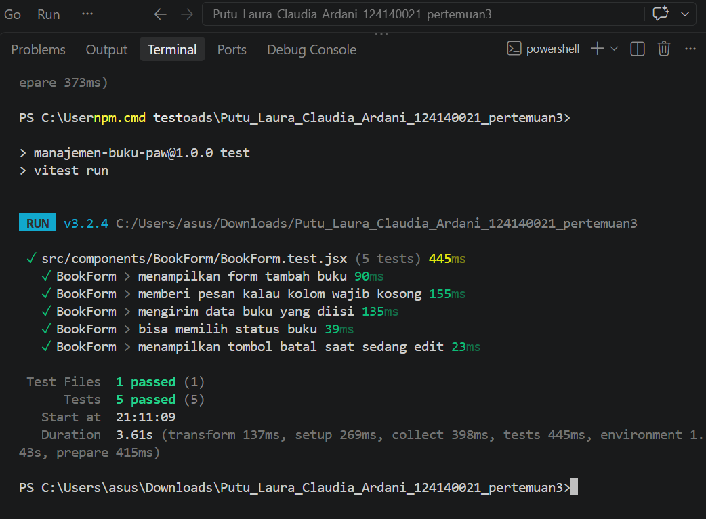
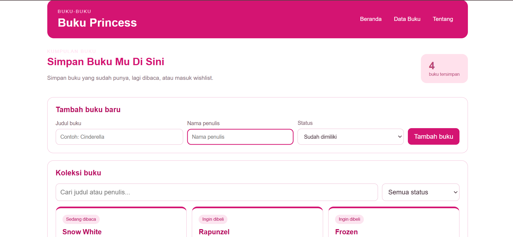

# Manajemen Buku Pribadi

Project Praktikum Pengembangan Aplikasi Web (PAW) Pertemuan 3 menggunakan React dan Vite. Aplikasi ini dibuat untuk membantu pengguna mencatat dan mengelola koleksi buku pribadi melalui website sederhana dengan tampilan putih dan magenta.

## Deskripsi Aplikasi

Manajemen Buku Pribadi adalah aplikasi untuk menyimpan dan mengatur informasi buku yang dimiliki pengguna. Aplikasi ini menyediakan fitur untuk menambahkan buku, melihat daftar koleksi, mengubah informasi buku, menghapus buku, serta mencari dan menyaring koleksi berdasarkan pilihan yang tersedia.

Data buku disimpan menggunakan `localStorage` pada browser, sehingga data tetap tersedia ketika halaman dibuka kembali menggunakan browser yang sama selama data penyimpanan browser tidak dihapus.

## Fitur Aplikasi

- Menambahkan buku baru ke dalam koleksi.
- Menampilkan daftar buku yang tersimpan.
- Mengedit informasi buku.
- Menghapus buku tertentu.
- Menghapus semua buku dengan konfirmasi pengguna.
- Mencari buku berdasarkan informasi yang tersedia.
- Menyaring daftar buku sesuai pilihan yang tersedia.
- Menampilkan statistik koleksi buku.
- Menyimpan data buku menggunakan `localStorage`.
- Menampilkan indikator mode layar mobile atau desktop berdasarkan lebar layar.

## Teknologi dan Fitur React yang Digunakan

- React Functional Components: membagi antarmuka aplikasi menjadi beberapa komponen.
- React Hooks: mengelola state dan menjalankan efek tertentu pada komponen.
- Props dan Children Props: mengirimkan data atau konten dari satu komponen ke komponen lainnya.
- Context API: membagikan data dan fungsi pengelolaan buku ke komponen yang membutuhkannya.
- React Router: mengatur perpindahan halaman dalam aplikasi.
- Custom Hooks: menggunakan kembali logika tertentu melalui hook `useBookStats` dan `useWindowSize`.
- localStorage: menyimpan data buku pada browser.
- Vite: menjalankan server pengembangan aplikasi.
- Testing: menguji fungsi tertentu pada aplikasi melalui pengujian otomatis.

## Cara Instalasi dan Menjalankan Aplikasi

1. Pastikan Node.js dan npm sudah terpasang di komputer.
2. Buka folder proyek menggunakan Visual Studio Code.
3. Buka terminal pada folder proyek.
4. Jalankan perintah berikut untuk memasang dependensi:

   ```bash
   npm install
   ```

5. Jalankan aplikasi menggunakan perintah:

   ```bash
   npm run dev
   ```

6. Buka alamat lokal yang muncul di terminal. Biasanya alamat tersebut adalah `http://localhost:5173/`.

## Menjalankan Testing

Untuk menjalankan pengujian otomatis, gunakan perintah berikut:

```bash
npm test
```

Tunggu sampai proses pengujian selesai. Hasilnya dapat digunakan untuk mengetahui apakah bagian aplikasi yang diuji berjalan sesuai harapan.

### Screenshot Hasil Testing



## Screenshot Antarmuka Aplikasi

Berikut merupakan tampilan halaman utama aplikasi Manajemen Buku Pribadi.



## Isi Project

- **`src/`**: berisi kode utama aplikasi, termasuk komponen, halaman, context, dan custom hooks.
- **`latihan/`**: berisi latihan mandiri terkait materi React.
- **`screenshots/`**: tempat menyimpan screenshot antarmuka aplikasi dan hasil testing.

## Penyimpanan Data

Data buku disimpan di `localStorage` browser. Data tersebut tetap tersedia ketika aplikasi dibuka kembali menggunakan browser yang sama selama penyimpanan browser tidak dihapus. Jika data `localStorage` dihapus, data buku yang tersimpan di dalamnya juga akan hilang.
