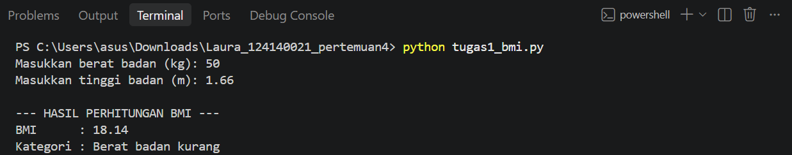
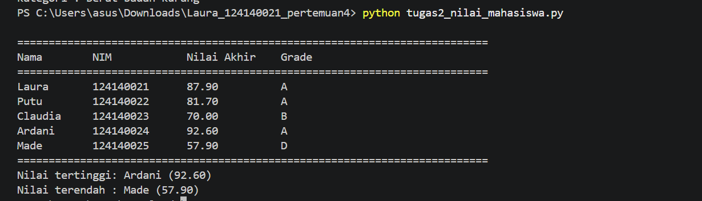
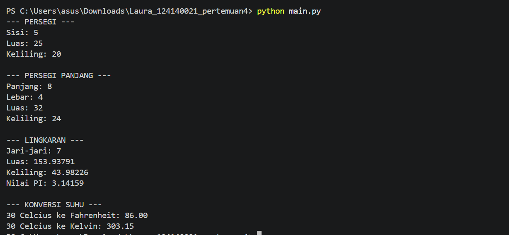

# Praktikum PAW Pertemuan 4 – Python Dasar

**Nama:** Putu Laura Claudia Ardani  
**NIM:** 124140021

## 1. Soal 1 – Menghitung BMI

File: `tugas1_bmi.py`

Program ini digunakan untuk mengetahui nilai BMI dari berat dan tinggi badan. Pengguna cukup memasukkan berat badan (kg) dan tinggi badan (m), kemudian program akan menghitung BMI dan menampilkan hasil beserta kategorinya.

**Screenshot hasil eksekusi:**



## 2. Soal 2 – Mengolah Nilai Mahasiswa

File: `tugas2_nilai_mahasiswa.py`

Program ini digunakan untuk menghitung nilai akhir mahasiswa berdasarkan nilai yang sudah dimasukkan. Selain itu, program juga menentukan grade setiap mahasiswa serta menampilkan nilai tertinggi dan terendah dari seluruh data.
**Screenshot hasil eksekusi:**



## 3. Soal 3 – Operasi Matematika

File: `math_operations.py` dan `main.py`

Pada soal ini, file math_operations.py berisi beberapa fungsi untuk menghitung luas dan keliling bangun datar serta mengubah suhu. Sementara itu, file main.py digunakan untuk menjalankan fungsi-fungsi tersebut dan menampilkan hasil perhitungannya di terminal.

**Screenshot hasil eksekusi:**



## 4. Cara Menjalankan Program

Untuk menjalankan programnya , buka folder praktikum di VS Code, kemudian buka terminal. Pastikan terminal sudah berada di dalam folder praktikum. Setelah itu, jalankan file yang ingin digunakan dengan perintah berikut.

**Latihan mandiri:**

```bash
python latihan1.py
python latihan2_suhu.py
python latihan3_tebak.py
python latihan4_validasi.py
python latihan5_kontak.py
python latihan6_password/main.py
```

**Tugas praktikum:**

```bash
python tugas1_bmi.py
python tugas2_nilai_mahasiswa.py
python main.py
```
