# Praktikum Pengembangan Aplikasi Web - Pertemuan 6

## Identitas

- Nama: Putu Laura Claudia Ardani
- NIM: 124140021
- Kelas: RB

## Deskripsi

Aplikasi RESTful API ini dibuat menggunakan Pyramid dan PostgreSQL untuk mengelola data Mahasiswa dan Mata Kuliah. Aplikasi menyediakan fitur untuk menampilkan, menambahkan, mengubah, dan menghapus data melalui metode GET, POST, PUT, dan DELETE.

## Persiapan

Pastikan Python dan PostgreSQL sudah terpasang di komputer.

Buat database dan user PostgreSQL melalui terminal:

```sql
CREATE DATABASE pyramid_mahasiswa;
CREATE USER pyramid_user WITH ENCRYPTED PASSWORD 'pyramid_pass';
GRANT ALL PRIVILEGES ON DATABASE pyramid_mahasiswa TO pyramid_user;
\c pyramid_mahasiswa
GRANT ALL ON SCHEMA public TO pyramid_user;
\q
```

## Instalasi dan Menjalankan Aplikasi

Buka terminal pada folder proyek, kemudian buat virtual environment:

```bash
python -m venv venv
```

Aktifkan virtual environment pada Windows:

```bash
venv\Scripts\activate
```

Untuk macOS/Linux:

```bash
source venv/bin/activate
```

Install library yang dibutuhkan:

```bash
python -m pip install --upgrade pip setuptools
python -m pip install -e ".[testing]"
python -m pip install psycopg2-binary
```

Pengaturan koneksi database terdapat pada file `development.ini`.

Jalankan migrasi database:

```bash
python -m alembic -c development.ini upgrade head
```

Masukkan data awal:

```bash
python -m pyramid_mahasiswa.scripts.initialize_db development.ini
```

Jalankan server:

```bash
pserve development.ini --reload
```

Server dapat diakses melalui:

`http://localhost:6543`

## Endpoint Mahasiswa

| Method | Endpoint              | Keterangan                   |
| ------ | --------------------- | ---------------------------- |
| GET    | `/api/mahasiswa`      | Menampilkan semua mahasiswa  |
| GET    | `/api/mahasiswa/{id}` | Menampilkan detail mahasiswa |
| POST   | `/api/mahasiswa`      | Menambahkan mahasiswa        |
| PUT    | `/api/mahasiswa/{id}` | Mengubah data mahasiswa      |
| DELETE | `/api/mahasiswa/{id}` | Menghapus mahasiswa          |

## Endpoint Mata Kuliah

| Method | Endpoint               | Keterangan                     |
| ------ | ---------------------- | ------------------------------ |
| GET    | `/api/matakuliah`      | Menampilkan semua mata kuliah  |
| GET    | `/api/matakuliah/{id}` | Menampilkan detail mata kuliah |
| POST   | `/api/matakuliah`      | Menambahkan mata kuliah        |
| PUT    | `/api/matakuliah/{id}` | Mengubah data mata kuliah      |
| DELETE | `/api/matakuliah/{id}` | Menghapus mata kuliah          |

## Contoh Pengujian cURL

Menampilkan seluruh data mata kuliah:

```bash
curl http://localhost:6543/api/matakuliah
```

Menampilkan detail mata kuliah:

```bash
curl http://localhost:6543/api/matakuliah/1
```

Menambahkan data mata kuliah:

```bash
curl -X POST http://localhost:6543/api/matakuliah -H "Content-Type: application/json" -d "{\"kode_mk\":\"IF4100\",\"nama_mk\":\"Keamanan Web\",\"sks\":3,\"semester\":5}"
```

Mengubah data mata kuliah:

```bash
curl -X PUT http://localhost:6543/api/matakuliah/1 -H "Content-Type: application/json" -d "{\"nama_mk\":\"Pemrograman Web Lanjut\"}"
```

Menghapus data mata kuliah:

```bash
curl -X DELETE http://localhost:6543/api/matakuliah/4
```

## Bukti Pengujian

Pengujian dilakukan menggunakan Postman untuk memastikan seluruh endpoint Mahasiswa dan Mata Kuliah dapat berjalan dengan baik.

### Pengujian Mahasiswa

1. POST Mahasiswa
2. GET Detail Mahasiswa
3. PUT Mahasiswa
4. DELETE Mahasiswa
5. GET Verifikasi Penghapusan
6. GET Seluruh Mahasiswa

### Pengujian Mata Kuliah

1. POST Mata Kuliah
2. GET Detail Mata Kuliah
3. PUT Mata Kuliah
4. DELETE Mata Kuliah
5. GET Verifikasi Penghapusan
6. GET Seluruh Mata Kuliah

## Bukti Pengujian

Pengujian dilakukan menggunakan Postman untuk memastikan seluruh endpoint Mahasiswa dan Mata Kuliah dapat berjalan sesuai fungsinya.

### A. Pengujian Endpoint Mahasiswa

**1. POST Mahasiswa**

Pengujian untuk menambahkan data mahasiswa baru.

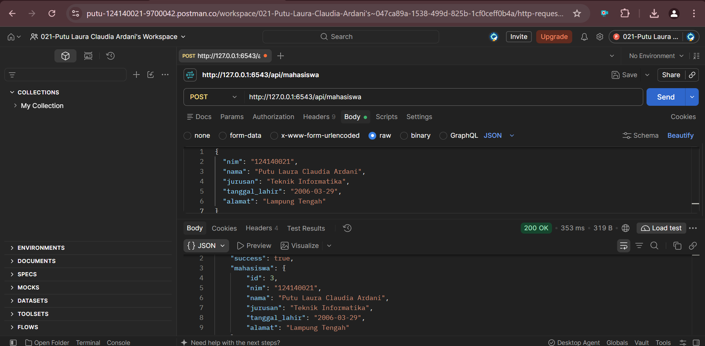

**2. GET Detail Mahasiswa**

Pengujian untuk menampilkan data mahasiswa berdasarkan ID.

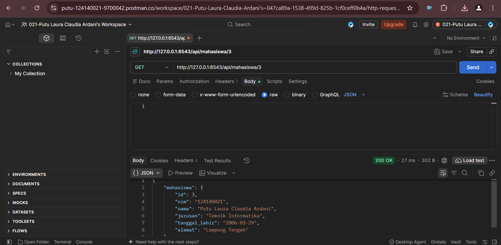

**3. PUT Mahasiswa**

Pengujian untuk mengubah data mahasiswa yang sudah tersimpan.

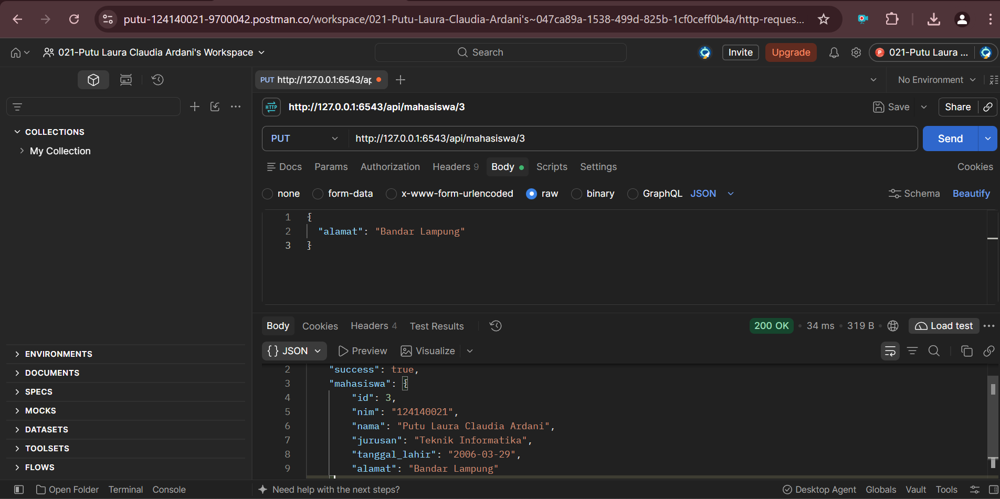

**4. DELETE Mahasiswa**

Pengujian untuk menghapus data mahasiswa berdasarkan ID.

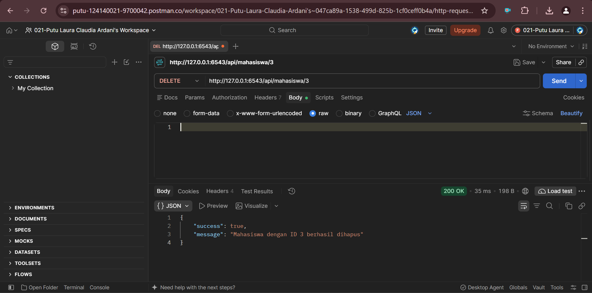

**5. Verifikasi DELETE Mahasiswa**

Pengujian untuk memastikan data mahasiswa berhasil dihapus.

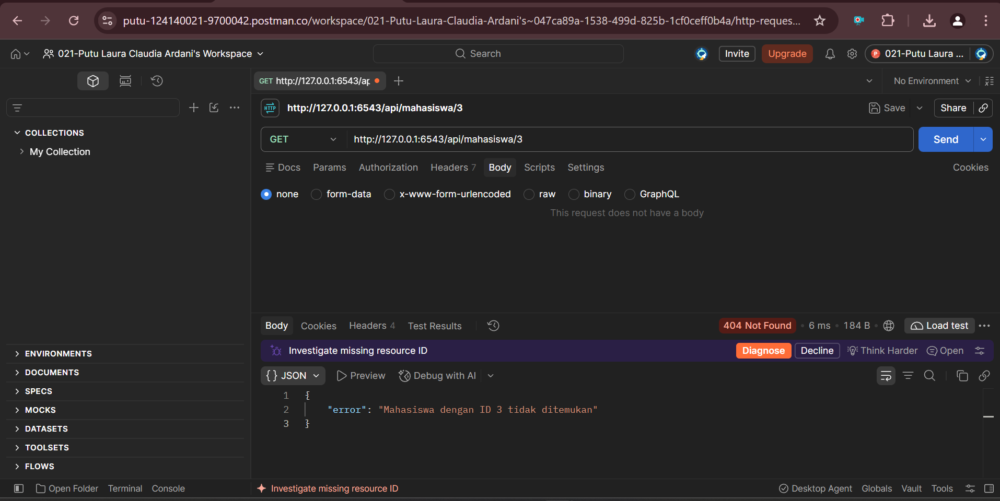

**6. GET Seluruh Mahasiswa**

Pengujian untuk menampilkan seluruh data mahasiswa yang tersimpan.

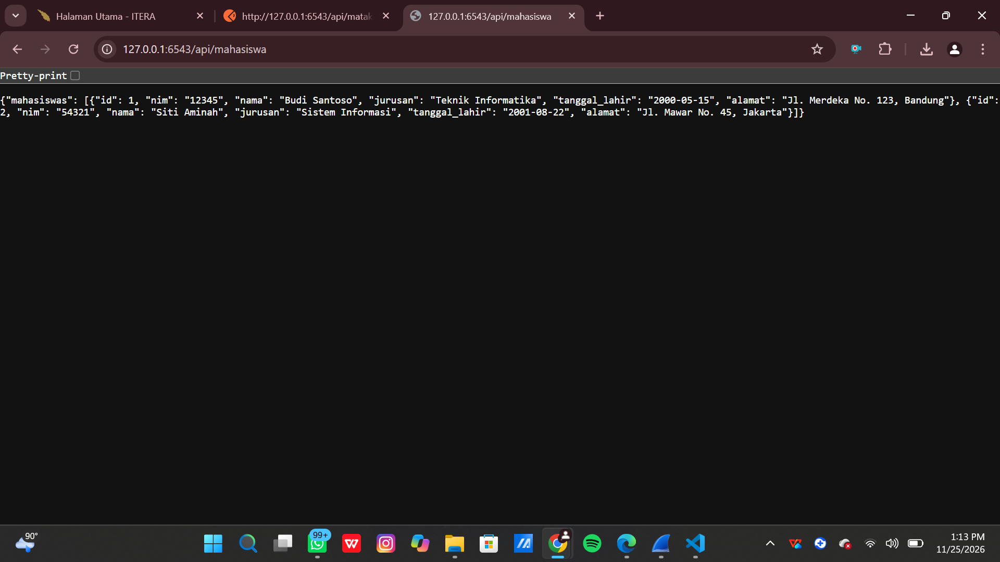

### B. Pengujian Endpoint Mata Kuliah

**1. POST Mata Kuliah**

Pengujian untuk menambahkan data mata kuliah baru.

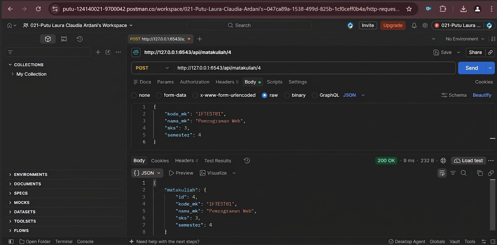

**2. GET Detail Mata Kuliah**

Pengujian untuk menampilkan data mata kuliah berdasarkan ID.

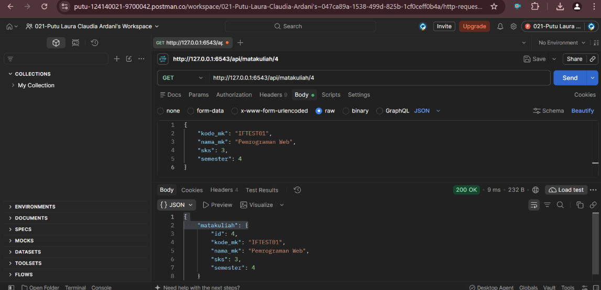

**3. PUT Mata Kuliah**

Pengujian untuk mengubah data mata kuliah yang sudah tersimpan.

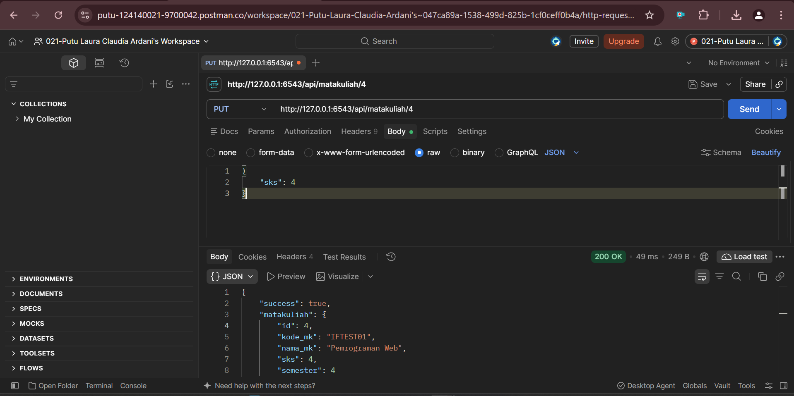

**4. DELETE Mata Kuliah**

Pengujian untuk menghapus data mata kuliah berdasarkan ID.

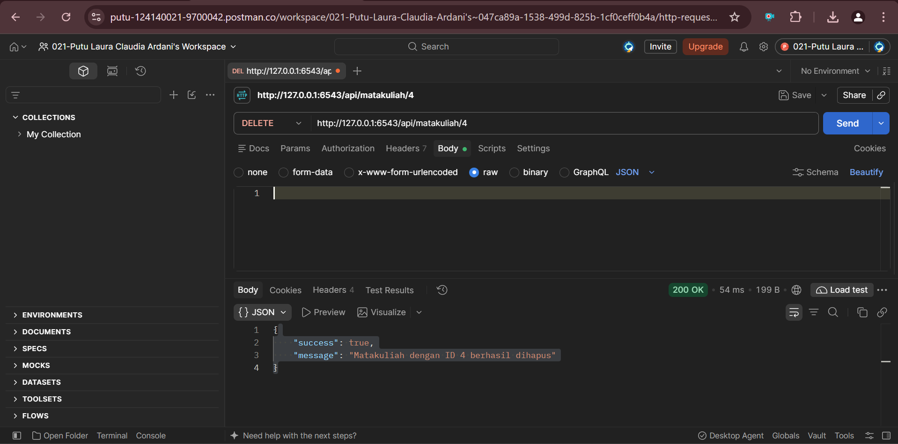

**5. Verifikasi DELETE Mata Kuliah**

Pengujian untuk memastikan data mata kuliah berhasil dihapus.

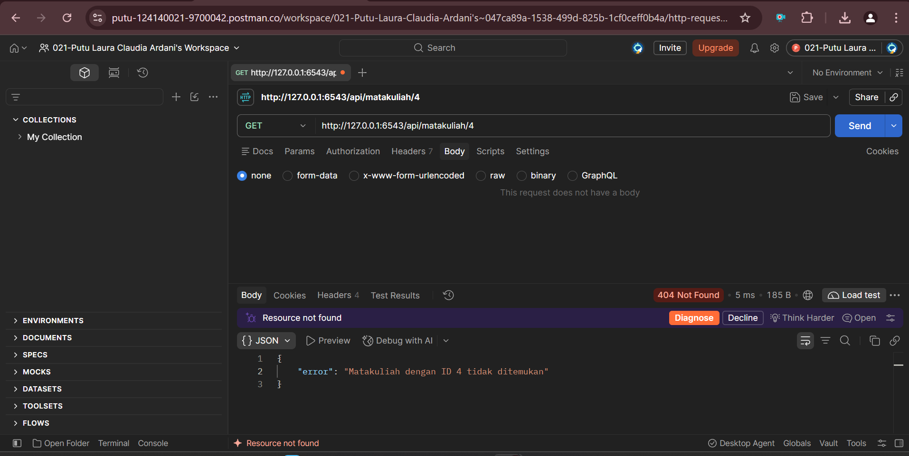

**6. GET Seluruh Mata Kuliah**

Pengujian untuk menampilkan seluruh data mata kuliah yang tersimpan.

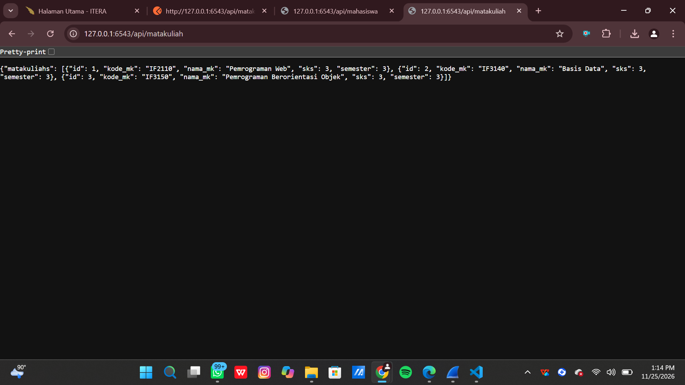
